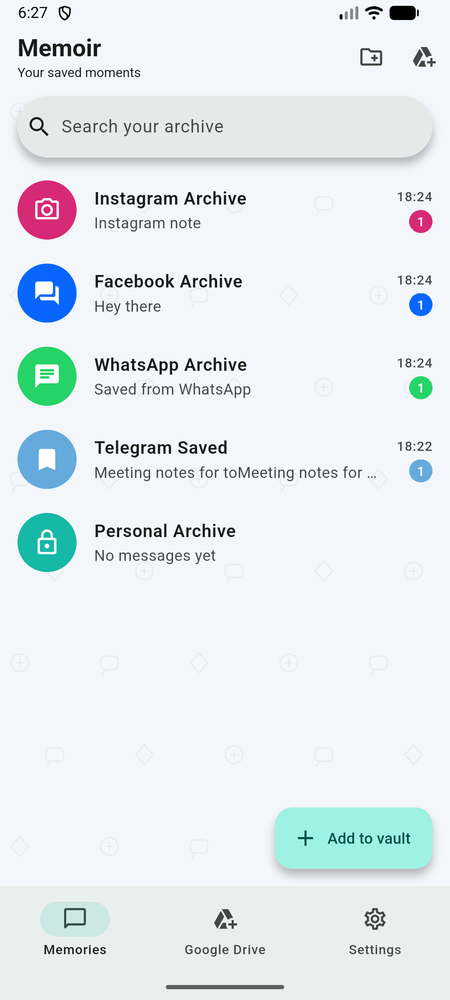
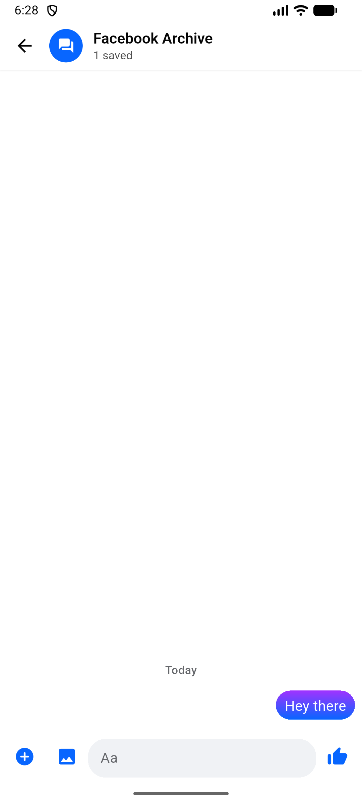
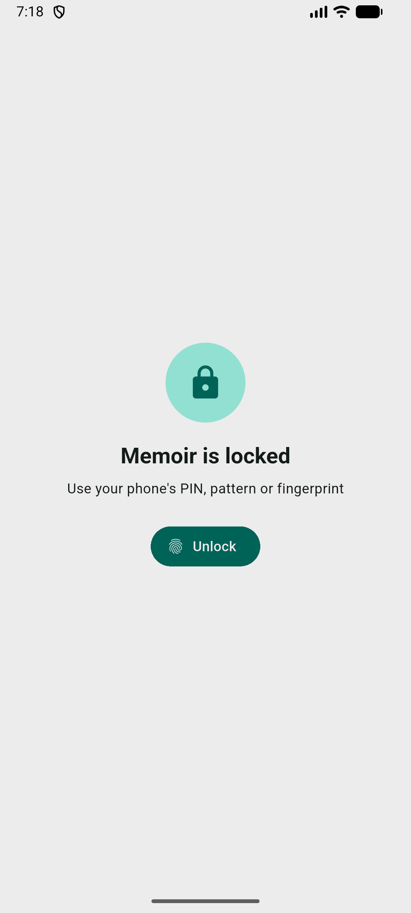
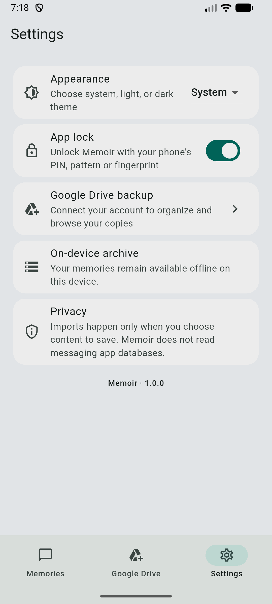

# Memoir

<div dir="rtl">

**Memoir** تطبيق أرشيف شخصي وخاص. احفظ فيه الرسائل والروابط والصور والملفات المهمة، ونظّمها في محادثات تشبه تليجرام وواتساب وماسنجر وإنستغرام، واحمها بقفل هاتفك، وانسخها احتياطيًا إلى Google Drive الخاص بك.

## ⬇️ التحميل

من صفحة **[الإصدارات (Releases)](../../releases/latest)**:

| الجهاز | الملف |
|---|---|
| أغلب هواتف أندرويد الحديثة | `Memoir-arm64-release.apk` |
| هواتف أندرويد القديمة جدًا | `Memoir-armv7-release.apk` |
| آيفون (iOS 15 فما فوق) | `Memoir-ios-unsigned.ipa` (انظر الملاحظة) |

**التثبيت على أندرويد:** حمّل ملف APK وافتحه. إذا طلب الهاتف ذلك، اسمح بـ«تثبيت تطبيقات من مصادر غير معروفة».

**التثبيت على آيفون:** آبل لا تسمح بتثبيت التطبيقات من خارج App Store مباشرة. ملف IPA غير موقّع، ويمكن تثبيته بأداة مثل [AltStore](https://altstore.io) أو [Sideloadly](https://sideloadly.io) مع Apple ID مجاني (التوقيع المجاني يحتاج تجديدًا كل 7 أيام).

## ✨ المميزات

- **محادثات بشكل تطبيقك المفضّل:** كل مجموعة تظهر كمحادثة بألوان وفقاعات وخلفية تشبه تليجرام أو واتساب أو ماسنجر أو إنستغرام، مع وضع ليلي.
- **ألبومات صور:** الصور المرسلة معًا تظهر كمجموعة واحدة.
- **عارض صور** بملء الشاشة مع تكبير وسحب، و**حفظ في المعرض** بضغطة.
- **قفل التطبيق** ببصمة الإصبع أو PIN أو النمط (نفس قفل هاتفك).
- **نسخ احتياطي إلى Google Drive:** يرفع العناصر الجديدة فقط، عدة ملفات في نفس الوقت، داخل مجلد `Memoir` منظّم (Photos, Videos, Documents…).
- **نسخ احتياطي تلقائي يومي** في الوقت الذي تختاره، ينتظر الاتصال بالإنترنت ويعيد المحاولة تلقائيًا.
- **11 لغة:** العربية، الإنجليزية، الفرنسية، الإسبانية، البرتغالية، الألمانية، الروسية، الصينية، اليابانية، الهندية، التركية، مع اختيار اللغة من الإعدادات.
- **تشغيل الفيديو** داخل التطبيق، أو فتحه بتطبيق آخر، أو في Google Drive.
- **الاسترجاع بعد إعادة التثبيت:** سجّل الدخول بنفس الحساب، فيجد Memoir نسختك في Drive ويعيد كل رسالة وصورة وفيديو إلى محادثتها.
- **نسخ إلى عدة حسابات Google (أندرويد):** أضف حسابين أو ثلاثة أو أكثر، فتُنسخ كل رسالة وصورة إلى كل حساب. إذا فقدت أحد الحسابات تبقى نسختك في الآخر.
- **المحذوفات مؤخرًا:** ما تحذفه يبقى 30 يومًا ويمكن استرجاعه، مع زر «تراجع» فور الحذف.
- **المشاركة إلى Memoir:** من أي تطبيق اضغط «مشاركة» ثم Memoir، واختر المحادثة التي تحفظ فيها النص أو الصور أو الملفات.
- **كل مستخدم يستعمل حسابه:** سجّل الدخول بحساب Gmail الخاص بك، فتُحفظ نسختك في مجلد `Memoir` داخل Google Drive الخاص بك أنت فقط.

**ملاحظة عند تسجيل الدخول بجوجل:** إذا ظهرت رسالة «Google hasn't verified this app»، اضغط **Advanced** ثم **Go to Memory Vault**. التطبيق لا يرى إلا الملفات التي أنشأها هو في Drive الخاص بك.
- **بحث** في كل ما حفظته، وتثبيت ومفضّلة ونسخ وحذف.
- **خصوصية:** كل شيء على هاتفك. لا خوادم ولا إعلانات ولا تتبّع.

</div>

## Screenshots

<p>
  
  
  
  
</p>

## English

**Memoir** is a private, local-first archive. Save messages, links, photos and files into chats styled like Telegram, WhatsApp, Messenger and Instagram, lock the app with your phone's screen lock, and back everything up to your own Google Drive.

**Download:** grab the latest APK (Android) or unsigned IPA (iOS 15+) from **[Releases](../../releases/latest)**. Most Android phones need `Memoir-arm64-release.apk`. The iOS build must be signed by you (e.g. with AltStore or Sideloadly) before it can be installed.

**Features**

- Per-app chat themes (bubbles, wallpapers, composers, dark mode) drawn entirely in code
- Photo albums for files sent together, a full-screen viewer, and save-to-gallery
- App lock with fingerprint, face, PIN or pattern via the system prompt
- Incremental, parallel Google Drive backup using the minimal `drive.file` scope
- Daily automatic backup at a time you pick; waits for internet and retries
- 11 languages (Arabic, English, French, Spanish, Portuguese, German, Russian, Chinese, Japanese, Hindi, Turkish) with an in-app picker
- In-app video player, plus open with another app or in Google Drive
- Restore after reinstalling: sign in with the same account and Memoir puts everything back in its chats
- Back up to several Google accounts at once (Android), so losing one account does not lose your archive
- Recently deleted: deleted items are kept for 30 days, with Undo right after deleting
- Share to Memoir from any app (text, photos, videos, files) and pick the chat to save into
- Each user signs in with their own Google account and gets their own `Memoir` folder in their own Drive
- Search, pin, favorite, copy and delete
- No server, ads, analytics or tracking. See [PRIVACY.md](PRIVACY.md)

## Build from source

Requirements: Flutter 3.47.8 (Dart 3.13), Android SDK; Xcode on macOS for iOS.

```bash
flutter pub get
flutter test
flutter build apk --release --split-per-abi --tree-shake-icons
```

- **Signing:** release builds use `android/key.properties` + a keystore when present (both are git-ignored), and fall back to the debug key otherwise.
- **Google sign-in:** the OAuth client IDs in the code belong to the official Memoir builds and only work for APKs signed with the official key. For your own build, create Android/iOS OAuth clients in Google Cloud Console with your package name and SHA-1, enable the Google Drive API, and replace the client IDs in `lib/src/cloud/google_drive_provider.dart` and `ios/Runner/Info.plist`.
- **iOS:** `flutter build ios --release --no-codesign` (macOS only). The [iOS workflow](.github/workflows/ios.yml) builds it on GitHub Actions and attaches the IPA to each release. Flutter apps require iOS 15 or newer.

## Project layout

| Path | What it is |
|---|---|
| `lib/src/archive/` | SQLite storage (schema v2: albums via `group_id`, backup tracking via `drive_id`) |
| `lib/src/chat/chat_style.dart` | Per-app chat themes and doodle wallpapers |
| `lib/src/screens/` | Chat list, chat, Google Drive and settings screens |
| `lib/src/cloud/` | Google Drive connector (REST, `drive.file` scope) |
| `lib/src/security/app_lock.dart` | App lock using `local_auth` |

## License

[MIT](LICENSE)
